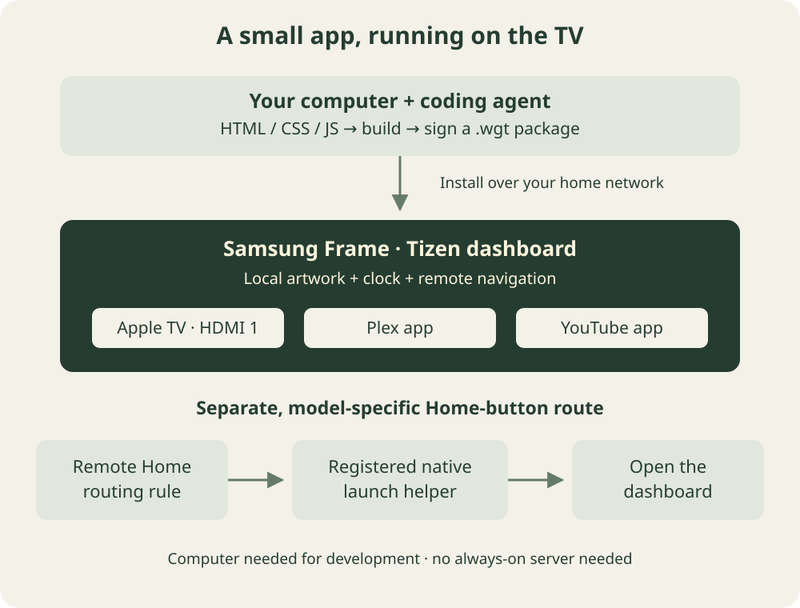

I posted a short video of my Samsung Frame TV on X, and people started asking how I did it. Here’s the walkthrough, including the part that took the most experimentation: making the remote’s Home button open my own screen.

The screen itself is simple. A painting fills the display. The time and date sit at the top. Three small icons open my Apple TV’s HDMI input, Plex, and YouTube. A warm glow shows which icon is selected.

<figure>
  <video controls muted playsinline preload="metadata" poster="./images/banner.jpg" width="1920" height="1080" style="display:block;width:100%;height:auto" aria-label="Short demonstration of my custom Samsung Frame TV dashboard">
    <source src="./frame-dashboard.mp4" type="video/mp4">
    <a href="./frame-dashboard.mp4">Watch the dashboard demonstration.</a>
  </video>
  <figcaption>The clip I shared, with the audio removed.</figcaption>
</figure>

I used Codex, but you can use your favorite coding agent. The useful capabilities are access to your local files, a terminal, current documentation, and your home network. This is a project where the agent needs to build and debug real software, not just produce a mockup.

## What’s actually running on the TV?

It’s a small **Tizen web app**, written in HTML, CSS, and JavaScript, packaged and signed for the TV. The artwork is bundled with it. There’s no backend, and I don’t need to leave my computer running to serve the screen.

The computer connects to the TV over the home network to install and debug it. I didn’t need a USB or HDMI cable between my computer and the TV. My physical Apple TV is still connected to HDMI 1.

This is separate from Samsung’s native Art Mode. It’s a foreground app that happens to look like a painting with a few controls. I previously wrote about [preparing artwork for the Frame’s Art Mode](/blog/samsung-frame-tv-image-script/); this project adds a launcher interface.



Here’s the setup we actually got working:

| Component | My setup |
| --- | --- |
| TV | 50-inch Samsung Frame, 2021 |
| Model | QN50LS03AAFXZA |
| Firmware | T-NKM2AKUC-2310.0 |
| TV platform | Tizen 6.0, ARMv7 |
| Development computer | Apple silicon Mac |
| Dashboard | Plain HTML, CSS, and JavaScript |
| Shortcuts | Apple TV on HDMI 1, installed Plex and YouTube apps |

**The normal app installation and the Home-button modification are two different jobs.** Samsung documents the first. The second used an unsupported, model-specific native routing method. My result isn’t proof that the same packages will work on every Frame or firmware version.

## Start by asking your agent to identify the TV

I didn’t even know the year of mine when we started. A photo of the TV’s information screen helped establish what we were dealing with. Give your agent the model and software version before it starts proposing a solution.

Here’s a starter prompt you can adapt. These prompts capture the workflow; they aren’t a verbatim transcript.

```text
Help me build a custom home dashboard for my Samsung Frame TV.
Work in a new local project directory.

First identify my TV model, firmware, and Tizen version. Tell me
where to find anything you cannot inspect. Use Samsung's current
TV developer documentation for setup and API compatibility.

Build a minimal local Tizen web app with a background image,
time, date, and shortcuts for my favorite apps and HDMI input.
It must work with the remote's arrows, Enter, and Back.
Keep assets local so the computer isn't needed after installation.

Get the app running normally before investigating the Home button.
Record the build, signing, installation, and recovery steps.
Do not assume that browser JavaScript can intercept system keys.
```

## Enable Developer Mode and connect over the network

The basic path is to install Tizen Studio with Samsung’s TV tools and certificate support, enable Developer Mode on the TV, and connect with Samsung’s device bridge, `sdb`. Samsung’s [TV device guide](https://developer.samsung.com/smarttv/develop/getting-started/using-sdk/tv-device.html) covers the connection process, and its [certificate guide](https://developer.samsung.com/smarttv/develop/getting-started/setting-up-sdk/creating-certificates.html) covers signing.

On my TV, the Developer Mode dialog was reached from the Apps screen by entering `12345`. My remote doesn’t have a physical keypad, so I used its on-screen number controls. The dialog needs the **computer’s IP address** as the developer host. The agent then connects to the **TV’s IP address**. Mixing those up is an easy mistake.

After changing Developer Mode, restart the TV properly. On mine, holding Power for about five seconds restarted it; a quick press just entered Art Mode.

With `sdb` on your path, the connection looks like this. Replace the example address with your TV’s address:

```bash
sdb connect TV_IP:26101
sdb devices
```

On my Mac, local network permissions were another wrinkle. Some commands could reach the TV while processes launched by the agent could not. Check macOS Local Network permissions for the terminal or agent host if that happens. A connection failure doesn’t necessarily mean Developer Mode is wrong.

Create your own Samsung signing profile through Certificate Manager, including your TV as a permitted device. You’ll need to handle the account login yourself. Keep the certificate files and passwords private; readers of your project need their own signing setup.

## Build the smallest useful app first

The first milestone should be boring: install a signed app, open it, and move focus between buttons with the remote. Artwork can come later.

```text
Build a minimal Tizen TV web app using HTML, CSS, and JavaScript.
Use real buttons with accessible labels and obvious keyboard focus.

Add three shortcuts:
- My physical Apple TV connected to HDMI 1
- The installed Plex app
- The installed YouTube app

Discover the installed application IDs from this TV. Do not guess
IDs from display names. Apple TV here means the HDMI device,
not Samsung's installed Apple TV streaming app.

Use the supported Tizen APIs for launching apps and selecting a
video source. Include the required privileges in config.xml.
Restore focus when the dashboard becomes visible again.
```

That Apple TV distinction mattered. Launching the installed Apple TV app and switching to an Apple TV box are different operations.

For Plex and YouTube, our app uses `tizen.application.launch()` with IDs discovered on the TV. For the HDMI shortcut, it discovers the video sources, chooses HDMI 1, calls `tizen.tvwindow.setSource()`, and hides the dashboard so the input is visible. The relevant references are Samsung’s [Application API](https://developer.samsung.com/smarttv/develop/api-references/tizen-web-device-api-references/application-api.html) and [TVWindow API](https://developer.samsung.com/smarttv/develop/api-references/tizen-web-device-api-references/tvwindow-api.html).

We used the `application.launch` and `tv.window` Tizen privileges. Have your agent check the API and privilege requirements for your target instead of copying an arbitrary manifest.

The build/install cycle looked like this, with project-specific values substituted. These commands assume the Tizen CLI is on your path and that you run them from the project directory:

```bash
tizen build-web -- .
tizen package -t wgt -s YOUR_SIGNING_PROFILE -- .buildResult

# Substitute the actual generated filename. A simple name avoids
# quoting trouble in later installation commands.
cp '.buildResult/Frame Dashboard.wgt' .buildResult/dashboard.wgt

tizen install -n dashboard.wgt -t YOUR_TARGET -- .buildResult
tizen run -p YOUR_APPLICATION_ID -t YOUR_TARGET
```

Ask your agent to resolve the target name and application ID from the tools and project files. Don’t leave placeholder values in the commands it runs.

## Make it look like something you want in your living room

The design took several rounds. I initially asked for a Monet-style background and matching painted app buttons. Later, I supplied a pastoral landscape and made the icons smaller, transparent, and farther apart.


An image-capable agent can generate the assets, or you can supply your own artwork. Here’s a background prompt along the lines of our first version:

```text
Create an original 16:9 oil painting in Claude Monet's
impressionist style for a Samsung Frame TV dashboard.
A tranquil water-lily pond, willow reflections, sage green,
lavender, cream highlights, visible brushwork, subtle canvas texture.
Keep the upper corners calm enough for a small clock and date.
No text, border, interface, or watermark.
```

For the icons, ask for separate assets with an actual alpha channel. A checkerboard painted into an image is not transparency.

```text
Create a small, recognizable Apple TV box and remote icon in a
painterly style that complements this background. Use a genuinely
transparent background, with no rectangular tile or scene behind it.
Keep the silhouette readable from across a room.

Then create separate matching Plex and YouTube icons with the same
palette, brushwork, visual scale, and transparent backgrounds.
```


The final simplification was mostly CSS:

```text
Remove the heading, greetings, visible app labels, and footer text.
Keep the date at the top right and move the time to the top left.
Keep the three small icons spaced apart near the bottom left.

Only the selected icon should have a warm glow behind it.
Make that glow pronounced enough to see across the room.
Keep accessible button names even though visible labels are removed.
Use CSS for the glow so it follows remote-control focus.
```

A TV is a good place to be ruthless about clutter. Test the result from the couch, using the remote, rather than judging everything in a desktop browser.

## The hard part: making Home open my app

Installing the dashboard didn’t replace Samsung’s Home screen. Pressing Home is a system-level action, and a key listener inside the web app doesn’t solve it when the TV is showing HDMI or another app.

We researched projects including [samsung-tizen-homekey](https://github.com/gtalusan/samsung-tizen-homekey) and [CleanFrame](https://github.com/nthnclrk/CleanFrame). Treat these as research starting points, with their own compatibility constraints, rather than universal installers.

Several approaches failed on my TV:

- Changing a `home_appid` setting read back successfully, but didn’t change what the physical Home button did.
- Registering a Home rule that pointed directly at the web app didn’t work.
- Routing Home through a native helper still didn’t work until that helper had the additional system registration it needed.

At one point, Home appeared to do nothing while I was on the Apple TV input. That’s why saving the original routing and preparing a way back mattered.

**The working arrangement on my TV used two signed native packages.** One supplied a tiny helper and the Home routing rule. The helper’s job was simply to launch the web dashboard. A second package registered that helper with the TV’s managed-app mechanism. Without that second registration, we could launch the helper manually, but the Home button still didn’t bring up the dashboard.

The native helper used Tizen’s application-control launch API. The routing relied on internal app-context behavior, including `managed_app` and `key_filter` registration. This was an unsupported modification, even though the dashboard itself was an ordinary signed web app. We didn’t flash firmware or obtain root access.

I’m describing the mechanism rather than handing out my signed packages: they are tied to my development setup, and the model and firmware details matter. This is the prompt I’d use for that stage:

```text
The dashboard is installed and works. Investigate whether my exact
TV model and firmware can route the remote's Home button to it.

Read current primary sources and relevant open-source implementations.
Separate documented app APIs from unsupported system-routing methods.
Inspect the current configuration before changing anything.

Save the exact original Home, Source, and other affected rules.
Prepare a concrete restore procedure before applying a modification.
Do not assume a successful install or database readback proves success.

If using a native launch helper, verify both that it launches the web
app directly and that the TV has the registration needed to route Home
to it. Preserve unrelated remote-button behavior.

Have me test the physical remote from HDMI and from other apps.
Record what actually works and what remains unverified.
```

Our recovery procedure restores the original routing through a signed restore package **before** removing the helper registration. Simply uninstalling the active routing package can remove rules it now owns. Have your agent prepare recovery for the exact method it chooses, not a generic “uninstall everything” instruction.

## Debug what the TV is doing, not what the agent expects

The most useful distinction was between “the package installed” and “the button worked.” Those are separate facts.

We inspected the web app’s debugger for visibility, focus, and application-control events. We also logged the native helper’s launch results. That let us tell the difference between a dashboard that couldn’t launch and a Home event that never reached the helper. General system logs weren’t available in a useful form on my setup.

```text
Help me diagnose this specific failure: the dashboard opens manually,
but pressing Home while on HDMI does not show it.

Inspect web-app visibility, focus, application-control events, and
runtime errors. If there is a native helper, log its launch result.
Test each hop separately: manual dashboard launch, direct helper
launch, then physical Home-button routing.

Tell me what the evidence proves. Don't call the fix successful
until I confirm the result using the actual remote.
```

Eventually, I pressed Home and it worked. That was the result I wanted: my own quiet screen, reachable with the button everyone already knows.

Before calling your version finished, test opening it from HDMI, returning from each app, remote navigation, and the restore procedure. Test restart behavior and Art Mode separately, too. **I confirmed the Home-button behavior on this setup; automatic startup after a cold boot and survival across firmware updates are not verified.**

The part I like most is how personal this can be. Start with one working button. Add the things your household actually uses. Give the agent screenshots, describe what feels wrong from the couch, and keep iterating until the screen feels like yours.
